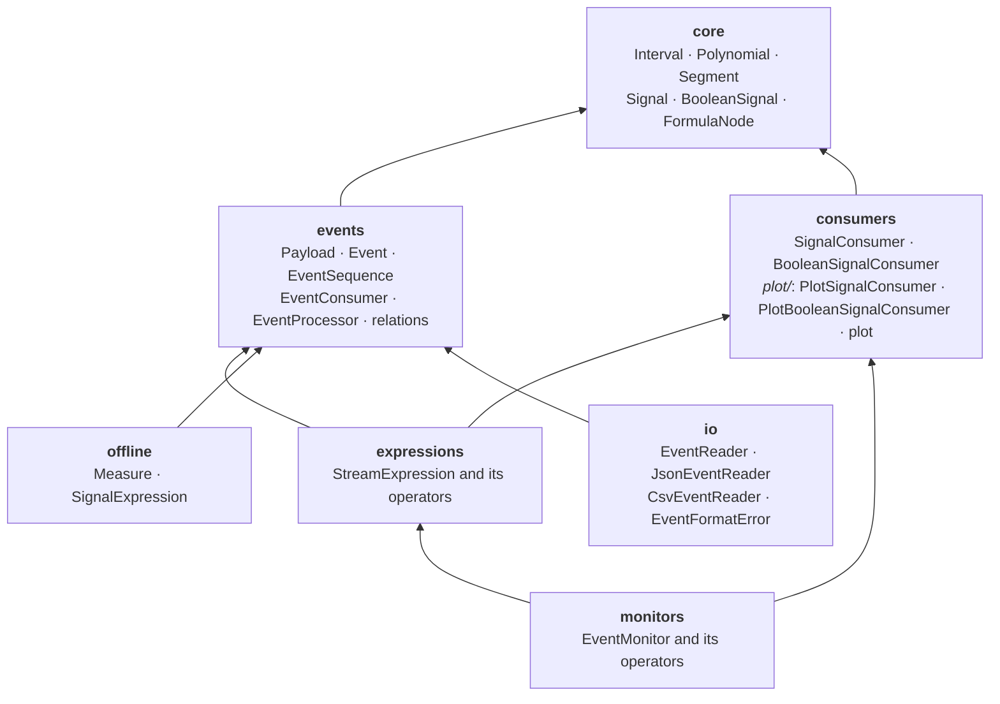
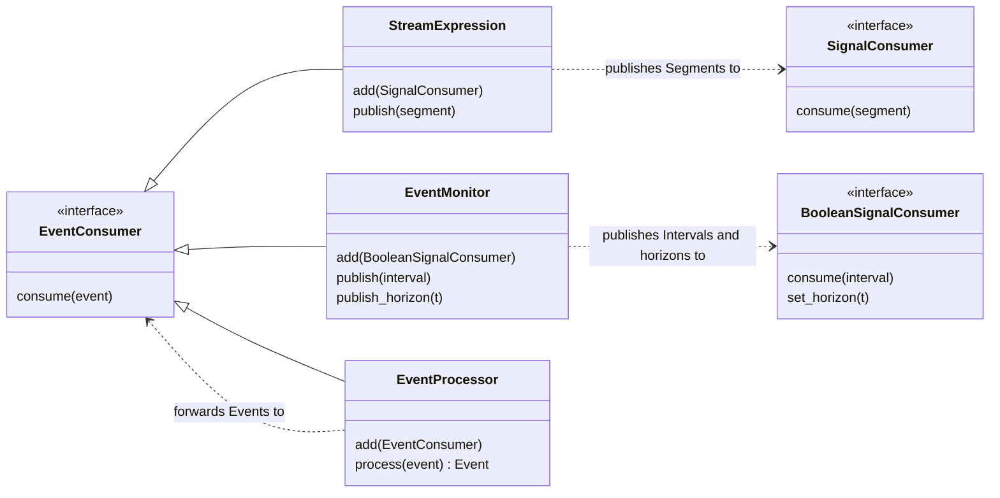
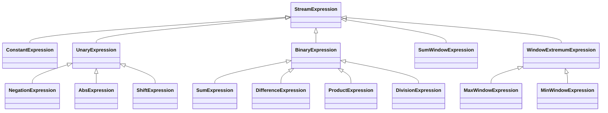
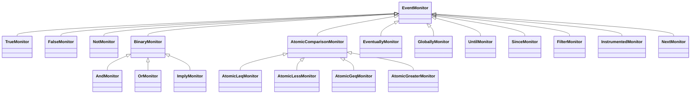
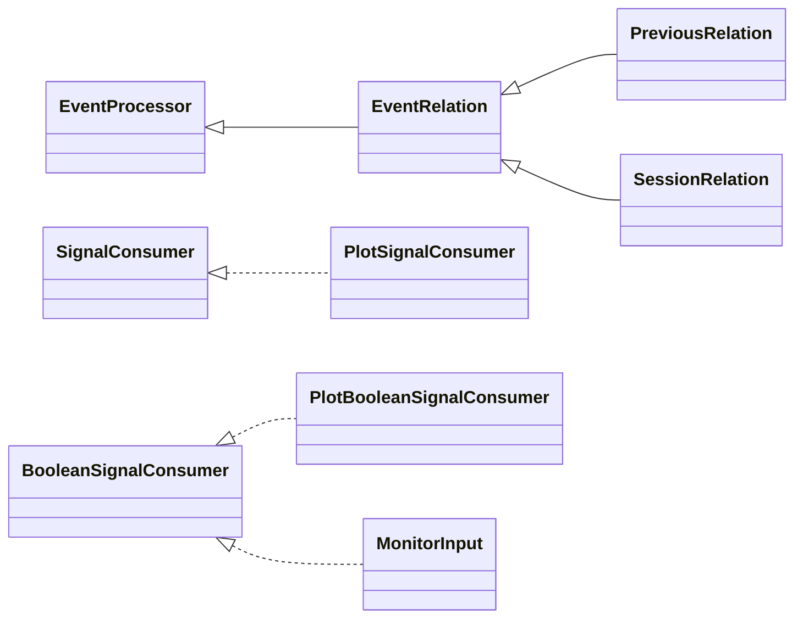

# Architecture and design patterns

## Layers

The library is a set of operators that are wired into trees and fed with
events. Each layer depends only on the layers below it:



| Package | Role |
| --- | --- |
| `cytlmonitor.core` | immutable values describing time and signals; no notion of streams |
| `cytlmonitor.events` | the input: events, and the interface of everything that consumes them |
| `cytlmonitor.consumers` | the output interfaces, implemented by whoever receives a signal; `consumers.plot` draws signals with Matplotlib and is the only part importing it |
| `cytlmonitor.expressions` | online operators turning events into a real-valued signal |
| `cytlmonitor.monitors` | online operators turning events into a boolean signal; atomic monitors compare two expressions |
| `cytlmonitor.offline` | functions over a complete `EventSequence`, outside the streaming model |
| `cytlmonitor.io` | readers building events from JSON and CSV files, checking times and field types |

Every public class is re-exported by `cytlmonitor` itself, so
`from cytlmonitor import AndMonitor` works whatever module the class lives in.
Each subpackage also re-exports its own classes
(`from cytlmonitor.monitors import AndMonitor`).

## The class hierarchy

Expressions and monitors are both event consumers. They differ in what they
publish, and so in the consumers they accept:



The operators specialise these three bases:







## Design patterns

### Push-based pipeline (Observer)

Data flows by *push*: a source calls `consume` on its operator, which updates
its state and calls `publish` on its own output. `publish` hands the result to
every consumer registered with `add`, in registration order. Each base class is
a subject with a typed list of observers:

| Subject | Observers | Notifications |
| --- | --- | --- |
| `EventProcessor` | `EventConsumer` | `consume(event)` |
| `StreamExpression` | `SignalConsumer` | `consume(segment)` |
| `EventMonitor` | `BooleanSignalConsumer` | `consume(interval)`, `set_horizon(t)` |

Nobody polls and nothing is buffered between stages, so each event goes all the
way through a tree of operators before `consume` returns. Any number of
observers can be attached to any node, including nodes nested inside another
operator: this is how the examples print or plot the intermediate signals of a
rule. Every expression and monitor is a `FormulaNode` (`cytlmonitor.core.node`):
its `operands`, `nodes()` and `node(path)` reach those nested nodes once the
tree is built, and `consumers.plot.plot` attaches plots to them.

### Composite: operators are trees

A formula such as `count_syn > 100 and not count_ack > 10` is a tree whose
nodes are operator objects, each holding its operands. The root is the only
object fed with events. Every inner node passes each event it consumes to its
children, and registers itself (through a private consumer, see *Adapter*
below) as an observer of their output. Building a monitor is therefore just
writing the formula as nested constructor calls:

```python
AndMonitor(
    AtomicGreaterMonitor(syns(), ConstantExpression(100)),
    NotMonitor(AtomicGreaterMonitor(acks(), ConstantExpression(10))),
)
```

A node must belong to one tree only, with one parent: each parent passes it
every event, so with two parents it would see every event twice. Functions such
as `syns()` above build a new node at every call. Passing the *same* object as
both operands of a binary operator is handled: it is fed once.

### Adapter: private consumers connect a node to its children

Each operator receives its children's output through an internal consumer
that adapts the child's notification interface into calls on the parent:

* `MonitorInput` (in `monitors.base`) is the `BooleanSignalConsumer` that
  binary and temporal monitors install in their operands. It buffers the
  intervals it receives, records the horizon, and calls back
  `owner._advance()` when the horizon moves.
* `_UnaryCollector`, `_BinaryCollector` and the `_Collector`s of the window and
  atomic modules do the same for segments.

The parent never subclasses or reaches into its children: it only sees what
they publish, as any other consumer would.

### Template Method: base classes own the protocol, subclasses the maths

The base classes implement buffering, alignment, publication and memory
management once; subclasses supply only what makes them different:

| Base class | Hook | Implemented by |
| --- | --- | --- |
| `UnaryExpression` | `_apply(segment)`: the segments covering the same interval | `NegationExpression`, `AbsExpression`, `ShiftExpression` |
| `BinaryExpression` | `_apply(p1, p2)`: combine two polynomials | `SumExpression`, `DifferenceExpression`, `ProductExpression`, `DivisionExpression` |
| `WindowExtremumExpression` | `_supersedes(a, b)`: is `a` a better candidate than `b` | `MaxWindowExpression`, `MinWindowExpression` |
| `BinaryMonitor` | `_combine(s1, s2, window)` and the class attribute `_dominant` | `AndMonitor`, `OrMonitor`, `ImplyMonitor` |
| `AtomicComparisonMonitor` | the class attributes `_strict` and `_reversed` | `AtomicLeqMonitor`, `AtomicLessMonitor`, `AtomicGeqMonitor`, `AtomicGreaterMonitor` |
| `EventProcessor` | `process(event)`: the event to forward, or `None` | `EventRelation` and user processors |
| `EventRelation` | `record(event)`: the past event it is related to, or `None` | `PreviousRelation`, `SessionRelation` |
| `EventReader` | `_records(handle, error)`: the records of a file, as Python values | `JsonEventReader`, `CsvEventReader` |

For instance, the four atomic comparisons are each a few lines declaring two
booleans; `AndMonitor` is `_combine = intersection` and `_dominant = (False,
False)`.

### Derived operators by composition

An operator that can be expressed through others is built from them instead of
being implemented again:

* `GloballyMonitor(m, I)` is `not eventually_I not m`: it builds a
  `NotMonitor(EventuallyMonitor(NotMonitor(m), I))` and republishes its
  output;
* `AtomicComparisonMonitor` compares `arg1` and `arg2` through an inner
  `DifferenceExpression`, then publishes where that single signal is positive;
* "the sum over the last `d` seconds" is `ShiftExpression(SumWindowExpression(w,
  0, d), d)` rather than a separate operator (see `count_last` in
  `examples/_traffic.py`).

### Immutable value objects

`Interval`, `Polynomial`, `Segment`, `Payload` and `Event` are immutable: their
fields are read-only properties, operations return new objects, and they
compare by value (`Interval`, `Payload` and `Event` are also hashable). Like
almost every class of the library, they use `__slots__` to stay small, since
monitors create many of them. `Payload` copies the dictionary it is given, so
later changes to that dictionary do not affect it. `Signal`, `BooleanSignal`
and `EventSequence` are append-only containers that check their ordering
invariants on every `add`.

### Facade

`cytlmonitor/__init__.py` and each subpackage's `__init__.py` re-export the
public classes, so user code depends on names rather than on the module layout.
Helpers that are not part of the API (`MonitorInput`, `complement_within`, the
`_Collector`s) live in the modules but are not exported from the package.

### Online algorithms with bounded state

Every operator processes each event in amortised constant time and keeps only
what can still affect future output:

* windows (`SumWindowExpression`, `WindowExtremumExpression`) keep the events
  or segments inside the window. Extrema use a monotonic queue: a candidate is
  dropped as soon as a later one supersedes it;
* binary and temporal monitors drop the intervals lying before their
  published horizon, and merge adjacent pieces of a long stretch into one
  interval (`MonitorInput.discard_before`, `compact`).

Memory therefore depends on the window lengths and on how bursty the signal
is, not on the length of the stream. `examples/scalability.py` measures this.

### Publishing as soon as the result is decided

A monitor publishes intervals together with a *horizon* `h`, meaning "my
signal is final on `[0, h)`". Operators advance their horizon as soon as their
result can no longer change, rather than when every input it depends on is
known:

* **Dominant values** (`BinaryMonitor`): `False and x` is false whatever `x`
  is, so And, Or and Imply move past the slower operand while the faster one
  holds its dominant value.
* **Lower and upper bounds** (`UntilMonitor`, `SinceMonitor`): the operators are
  monotone in their arguments, so their result is computed twice, with the
  unknown future of each argument taken as false and as true. Wherever the two
  agree, every possible future gives that value, so it is published.
* **True intervals of the argument** (`EventuallyMonitor`): an interval where
  `arg` is true immediately settles the part of the result that it makes true.

[The streaming model](streaming-model.md#when-results-are-published) describes
these rules with examples.

### One update per event

Monitors with two operands (`BinaryMonitor`, `UntilMonitor`, `SinceMonitor`)
pass an event to both operands first and update their own output once,
afterwards. Their operands notify them during that pass, but the update is
deferred until both are done. The result is no later, since the whole tree
handles an event inside one `consume` call, and it is published in fewer and
larger pieces.

### Errors are raised early

Constructors check the types of their arguments (`TypeError`) and the
validity of their parameters (`ValueError`: an unbounded window for
`UntilMonitor`, a degenerate open interval, events out of order in an
`EventSequence`). Containers check their ordering invariants on `add`. A
mistake in building a monitor therefore fails where it is made, not later on
the stream.
