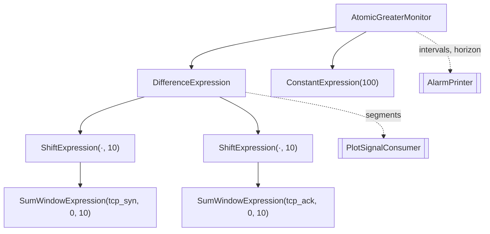
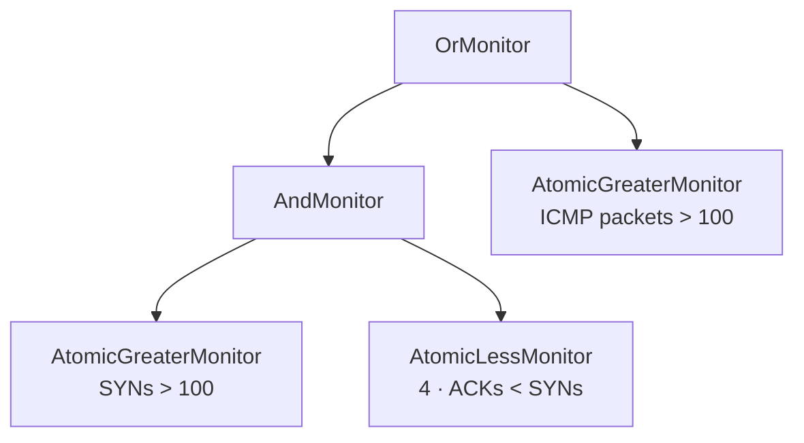
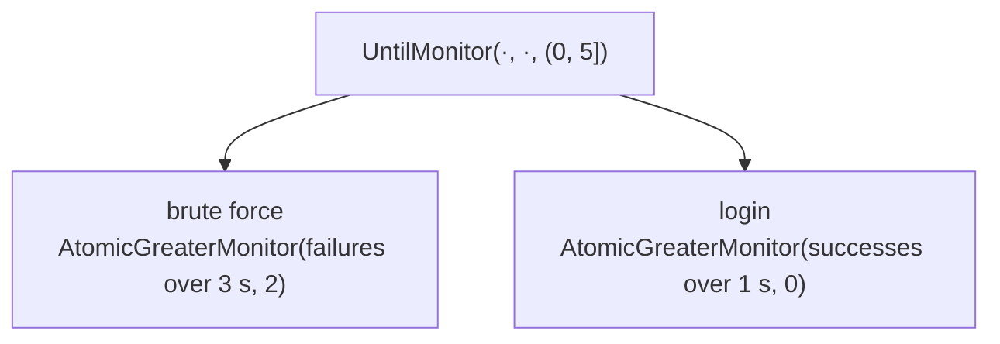

# Composing monitors

A property is written as a tree of operators: expressions at the bottom
compute quantities over the stream, atomic monitors compare them, and
connectives and temporal operators combine the comparisons. Only the root is
fed with events. Consumers can be attached to any node.

```pycon
>>> from cytlmonitor import *

```

## From a formula to a tree

The SYN flood rule of `examples/syn_flood.py` raises an alarm when the
half-open TCP connections over the last 10 seconds are more than 100:

    (SYNs in [t - 10, t]) - (ACKs in [t - 10, t]) > 100



```python
def count_last(seconds, weight):
    return ShiftExpression(SumWindowExpression(weight, 0, seconds), seconds)

half_open = DifferenceExpression(count_last(10, lambda e: e.payload.get('tcp_syn', 0)),
                                 count_last(10, lambda e: e.payload.get('tcp_ack', 0)))
flood = AtomicGreaterMonitor(half_open, ConstantExpression(100))
flood.add(AlarmPrinter('SYN flood'))
half_open.add(PlotSignalConsumer('Half-open connections'))   # an inner node
for event in stream:
    flood.consume(event)
```

The port-scan rule of `examples/port_scan.py` combines three comparisons,
each over the last 2 seconds, with connectives:



## A worked example: brute force until a login

An attacker tries passwords: each attempt is an event with a `login` field.
The breach rule says that more than two failures over the last three seconds
go on until a successful login, within five seconds:

    brute_force U(0,5] login



`Alarms` prints each alarm once it is over, merging the pieces it is
published in. One is attached to each node:

```pycon
>>> class Alarms(BooleanSignalConsumer):
...     def __init__(self, name):
...         self.name, self.signal, self.reported = name, BooleanSignal(), 0
...     def consume(self, i):
...         self.signal.add(i)
...     def set_horizon(self, t):
...         self.signal.set_horizon(t)
...         for i in list(self.signal)[self.reported:]:
...             if i.end is not None and i.end < t:
...                 print(f'{self.name}: {i}')
...                 self.reported += 1
>>> def count_last(seconds, weight):
...     return ShiftExpression(SumWindowExpression(weight, 0, seconds), seconds)
>>> def failures():
...     return count_last(3, lambda e: float(e.payload.get('login') == 'fail'))
>>> def successes():
...     return count_last(1, lambda e: float(e.payload.get('login') == 'ok'))
>>> brute_force = AtomicGreaterMonitor(failures(), ConstantExpression(2))
>>> login = AtomicGreaterMonitor(successes(), ConstantExpression(0))
>>> breach = UntilMonitor(brute_force, login, Interval(0, 5, left_open=True, right_open=False))
>>> for monitor, name in [(brute_force, 'brute force'), (login, 'login'), (breach, 'breach')]:
...     monitor.add(Alarms(name))
>>> attempts = [(t, 'fail') for t in (1, 1.5, 2, 2.5, 3, 3.5)] + [(4, 'ok')]
>>> quiet = [(t, None) for t in range(5, 21)]
>>> for t, outcome in attempts + quiet:
...     breach.consume(Event(t, Payload({} if outcome is None else {'login': outcome})))
brute force: [3.0,5.5]
login: [4.0,5.0]
breach: [3.0,5.0)

```

The brute force holds on `[3, 5.5]`, the login on `[4, 5]`. The breach holds
from 3, where the brute force starts and the login is one second away, up to 5,
where the last moment of the login is reached. The window `(0, 5]` excludes 0,
so the login alone does not make it true.

## Rules for building trees

**Build a new node for every use.** A parent passes every event to its
operands. A node shared by two parents therefore sees every event twice. Its
state is then wrong, and so are the results, without any error. Write the
operands as functions returning a new tree, as `failures()` above. Compare
"between 1 and 4 events over the last two seconds", built correctly and with
a shared count:

```pycon
>>> class Record(BooleanSignalConsumer):
...     def __init__(self):
...         self.signal = BooleanSignal()
...     def consume(self, i):
...         self.signal.add(i)
...     def set_horizon(self, t):
...         self.signal.set_horizon(t)
>>> def between(count):
...     m = AndMonitor(AtomicGreaterMonitor(count(), ConstantExpression(1)),
...                    AtomicLessMonitor(count(), ConstantExpression(4)))
...     out = Record()
...     m.add(out)
...     for t in [1, 1.5, 2, 2.5, 3, 6, 9]:
...         m.consume(Event(t, Payload({})))
...     return out.signal
>>> between(lambda: count_last(2, lambda e: 1.0))           # a new count for each use
BooleanSignal([[2.0,2.5), (3.5,4.5]])
>>> shared = count_last(2, lambda e: 1.0)
>>> between(lambda: shared)                                   # wrong: events counted twice
BooleanSignal([(4.5,5.0], [6.0,8.0]])

```

The same object passed as *both* operands of one binary operator,
`AndMonitor(m, m)`, is fine: it is fed once.

**Consumers can go anywhere.** Any number of consumers can be attached to any
node, including the operands of other nodes. They only observe, so they never
change the result.

**Feed the root, in time order.** Events must arrive in non-decreasing time
order. Several events may share a timestamp.

**Expect the warm-up.** A count over the last `d` seconds is 0 during the first
`d` seconds of the stream, before a full window exists.

## Derived operators as functions

Operators that are combinations of others are best written as functions
building the combination. "`m` was true at some point of the last `d`
seconds" is a since with a true first argument:

```pycon
>>> def once_within(m, d):
...     return SinceMonitor(TrueMonitor(), m, Interval(0, d, right_open=False))

```

The library does the same: `GloballyMonitor(m, I)` builds `not eventually_I
not m`, and atomic monitors compare two expressions through their difference.

## Writing a new operator

New operators subclass one of the base classes and keep to the contracts of
[the streaming model](streaming-model.md).

**A source monitor.** Subclass `EventMonitor` and implement `consume`. Publish
the true intervals in order, each after the previous one, then the horizon,
never moving it back. `Flag` is true from each event that sets a field up to
the next event:

```pycon
>>> class Flag(EventMonitor):
...     def __init__(self, field):
...         super().__init__()
...         self.field, self.since, self.on = field, 0.0, False
...     def consume(self, e):
...         if self.on and e.time > self.since:
...             self.publish(Interval(self.since, e.time))
...         self.on, self.since = bool(e.payload.get(self.field)), e.time
...         self.publish_horizon(e.time)
>>> def run(monitor, flags):
...     out = Record()
...     monitor.add(out)
...     for t, fields in enumerate(flags):
...         monitor.consume(Event(t, Payload(fields)))
...     return out.signal
>>> trace = [{'a': 1}, {'a': 1, 'b': 1}, {'b': 1}, {}, {}]
>>> run(Flag('a'), trace), run(Flag('b'), trace)
(BooleanSignal([[0.0,2.0)]), BooleanSignal([[1.0,3.0)]))
>>> run(once_within(Flag('a'), 1), trace)
BooleanSignal([[0.0,3.0]])

```

**A new connective.** Subclass `BinaryMonitor` and implement `_combine(s1, s2,
window)`, which combines the two operands' signals over the newly decided
part `window`. Set `_dominant` to the value of each operand that decides the
result alone, or `None` where there is none. Exclusive or has none:

```pycon
>>> from cytlmonitor.monitors import BinaryMonitor
>>> from cytlmonitor.monitors.base import complement_within
>>> class XorMonitor(BinaryMonitor):
...     _dominant = (None, None)
...     @staticmethod
...     def _combine(s1, s2, window):
...         return s1.union(s2).intersection(complement_within(s1.intersection(s2), window))
>>> run(XorMonitor(Flag('a'), Flag('b')), trace)
BooleanSignal([[0.0,1.0), [2.0,3.0)])

```

**A new expression.** Subclass `UnaryExpression` and implement `_apply(segment)`,
returning the segments covering the same interval. Use `BinaryExpression` with
a static `_apply(p1, p2)` for a point-wise operation on two signals:

```pycon
>>> from cytlmonitor.expressions import UnaryExpression
>>> class ScaleExpression(UnaryExpression):
...     def __init__(self, arg, k):
...         super().__init__(arg)
...         self.k = k
...     def _apply(self, s):
...         return [Segment(s.interval, s.polynomial.mul(Polynomial([self.k])))]
>>> class Values(SignalConsumer):
...     def __init__(self):
...         self.values = []
...     def consume(self, s):
...         self.values.append(s.polynomial.coefficients[0])
>>> scaled = ScaleExpression(count_last(2, lambda e: 1.0), 10)
>>> values = Values()
>>> scaled.add(values)
>>> for t in [1, 1.5, 2, 2.5, 3, 6]:
...     scaled.consume(Event(t, Payload({})))
>>> values.values
[0.0, 30.0, 40.0, 50.0, 40.0, 30.0, 20.0, 10.0, 0.0]

```

**An event processor.** Subclass `EventProcessor` and implement
`process(event)`, returning the event to forward or `None` (see
[events](events.md#eventprocessor)).

When writing a new operator with operands, follow the library's own: install a
consumer in each operand rather than reading its state, keep only what can
still change the output, and publish as soon as the result is decided.
