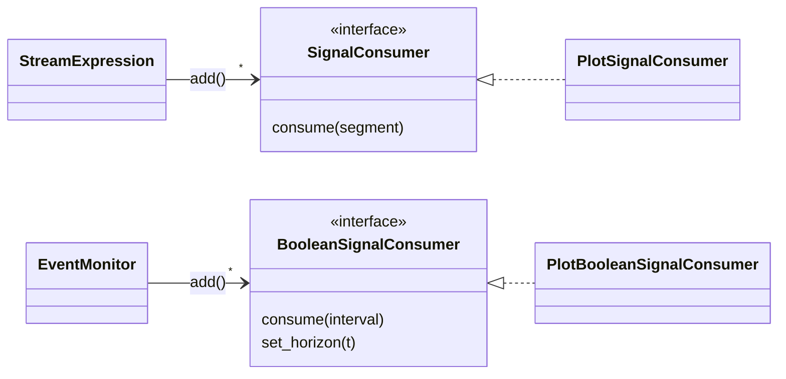

# Consumers (`cytlmonitor.consumers`)

Consumers receive what expressions and monitors publish. The library defines
the two interfaces, and two implementations that plot signals with
Matplotlib. Applications implement the interfaces for whatever they need to do
with a result: print alarms, store them, forward them.



## `SignalConsumer`

Receives the segments of a real-valued signal through `consume(segment)`,
contiguous and in time order from 0.

## `BooleanSignalConsumer`

Receives a boolean signal through two methods: `consume(interval)` for each
interval where it is true, in time order, and `set_horizon(t)` when the signal
becomes final up to `t`. See [the streaming
model](streaming-model.md#boolean-signals-intervals-and-horizons) for the
contract.

### Reassembling a signal

A monitor publishes a long true stretch in pieces, as each becomes known. To
get whole intervals, add the pieces to a `BooleanSignal`, which merges
adjacent intervals. An interval is complete once the horizon has passed its
end, since until then the next piece may continue it:

```pycon
>>> from cytlmonitor import *
>>> class Alarms(BooleanSignalConsumer):
...     """Prints each alarm once it is over."""
...     def __init__(self):
...         self.signal = BooleanSignal()
...         self.reported = 0
...     def consume(self, i):
...         self.signal.add(i)
...     def set_horizon(self, t):
...         self.signal.set_horizon(t)
...         for i in list(self.signal)[self.reported:]:
...             if i.end is not None and i.end < t:
...                 print('alarm on', i)
...                 self.reported += 1
>>> busy = AtomicGreaterMonitor(ShiftExpression(SumWindowExpression(lambda e: 1.0, 0, 2), 2),
...                             ConstantExpression(1))
>>> busy.add(Alarms())
>>> for t in [1, 2, 2.5, 6, 9]:
...     busy.consume(Event(t, Payload({})))
alarm on [2.0,4.0]

```

`AlarmPrinter` in `examples/_traffic.py` is a fuller version of this consumer.

## `PlotSignalConsumer`, `PlotBooleanSignalConsumer` (`cytlmonitor.consumers.plot`)

Consumers that draw the signal they receive with Matplotlib, while the stream
is processed:

* `PlotSignalConsumer(title='Signal', axes=None, samples=50,
  unbounded_extent=1.0, dark=False, refresh_interval=0.05)` draws the segments as one line. Constant
  segments are drawn from their endpoints, the others sampled. A jump between
  segments shows as a vertical step.
* `PlotBooleanSignalConsumer(title='Boolean signal', axes=None, unbounded_extent=1.0,
  dark=False, refresh_interval=0.05)` draws the boolean signal
  at 1 where it is true and at 0 where it is known to be false, with the
  horizon as a dashed vertical line. A dot at each end of an interval shows
  whether that end is included (at 1) or not (at 0). Adjacent pieces are drawn
  as one interval.

Both draw on the given Matplotlib `axes`, or on a new figure, and accept
`dark=True` for a dark theme. In interactive mode (`matplotlib.pyplot.ion()`)
they redraw at most every `refresh_interval` seconds, so that drawing does not
slow a busy stream down. Otherwise the figure is drawn by `show()` or
`savefig`. `refresh()` redraws at once. Matplotlib is imported only when a
plotting consumer is built: importing `cytlmonitor.consumers` does not load
it.

```python
import matplotlib.pyplot as plt
from cytlmonitor import (AtomicGreaterMonitor, ConstantExpression, PlotBooleanSignalConsumer,
                         PlotSignalConsumer, ShiftExpression, SumWindowExpression)

count = ShiftExpression(SumWindowExpression(lambda e: 1.0, 0, 10), 10)
alarm = AtomicGreaterMonitor(count, ConstantExpression(100))

figure, (top, bottom) = plt.subplots(2, 1, sharex=True)
count.add(PlotSignalConsumer('Packets over the last 10 s', axes=top))
alarm.add(PlotBooleanSignalConsumer('More than 100', axes=bottom))

for event in stream:          # any iterable of Events, in time order
    alarm.consume(event)
plt.show()
```

`cytlmonitor.consumers.plot.style` holds what the two share: the colour
themes (`THEMES`), `create_axes`, which styles the axes, and `Redrawer`, which
limits redraws to one every `refresh_interval` seconds.

The consumer plotting `count` is attached to an expression *inside* the
monitor. Any node of a tree can have consumers, which is how the examples plot
the intermediate signals of a rule. Every script in `examples/` accepts
`--plot`.
