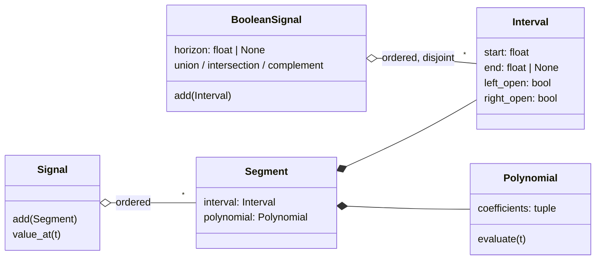

# Core data types (`cytlmonitor.core`)

The core types describe time and signals. They know nothing about events or
streams, and are immutable except for the two append-only containers,
`Signal` and `BooleanSignal`.



```pycon
>>> from cytlmonitor import Interval, Polynomial, Segment, Signal, BooleanSignal

```

## `Interval`

A range of times with a start, an optional end (`None` for `+inf`), and each
side open or closed. By default an interval is closed on the left and open on
the right, which is how monitors publish true stretches: `[a, b)` followed by
`[b, c)` covers `[a, c)` with no gap and no overlap.

```pycon
>>> Interval(1, 5), Interval(1, 5, left_open=True, right_open=False)
([1.0,5.0), (1.0,5.0])
>>> Interval(2), Interval.point(3)
([2.0,), [3.0,3.0])
>>> Interval(1, 5).contains(5)
False

```

**Ordering.** `is_before(i)` holds when the interval lies entirely before `i`;
`just_before(i)` when it ends exactly where `i` starts, with exactly one of the
two containing the shared point, so that they can be joined:

```pycon
>>> Interval(1, 3).is_before(Interval(3, 4)), Interval(1, 3).just_before(Interval(3, 4))
(True, True)
>>> Interval(1, 3).join(Interval(3, 4))
[1.0,4.0)
>>> Interval(1, 5).intersection(Interval(3, 8))
[3.0,5.0)

```

**Time operations.** `shift(t)` moves an interval by `t` (cutting what falls
before 0). `backward(i)` is the operation behind *eventually*: it returns the
times `t` from which some `t + t'`, with `t'` in `i`, falls in the interval.
If `arg` is true on `[10, 12]`, then "`arg` within `[2, 3]`" is true on
`[7, 10]`:

```pycon
>>> Interval(10, 12, right_open=False).backward(Interval(2, 3, right_open=False))
[7.0,10.0]
>>> Interval(2, 4).shift(-3)
[0.0,1.0)

```

`split(t)` cuts an interval in two at `t`; `complement(t)` returns the gap
from `t` to the start of the interval.

## `Polynomial`

A real polynomial `p(t) = a0 + a1·t + ... + an·tⁿ` of the absolute time `t`. The
operators of the library produce polynomials of degree 0 (counts, sums,
constants) and 1 (differences of shifted signals, ...); comparisons and
extrema support degree up to 2.

```pycon
>>> p = Polynomial([1, 2])                      # 1 + 2t
>>> p.evaluate(3)
7.0
>>> p.add(Polynomial([0, 0, 1])), p.mul(p)
(Polynomial([1.0, 2.0, 1.0]), Polynomial([1.0, 4.0, 4.0]))
>>> Polynomial([1, 0, 1]).sup(Interval(0, 2, right_open=False))
5.0

```

`positive(interval, strict)` splits an interval by the sign of the polynomial.
It is how atomic monitors turn a difference of two signals into the intervals
where a comparison holds:

```pycon
>>> Polynomial([-1, 0, 1]).positive(Interval(0, 3))   # t² - 1 on [0, 3)
[([0.0,1.0], False), ((1.0,3.0), True)]

```

`shift(v)` returns the polynomial describing the same function moved `v`
forward in time (`p(t - v)`). `integral(v)` returns `x ↦ ∫ₓ^{x+v} p`, and
`compute_integral(interval)` a definite integral. `div` only accepts a
nonzero constant. `Polynomial.ZERO` is the zero polynomial.

```pycon
>>> Polynomial([0, 1]).shift(2)                 # t moved 2 forward: t - 2
Polynomial([-2.0, 1.0])

```

## `Segment`

An `Interval` with the `Polynomial` giving the signal's value there: one
piece of a piecewise-polynomial signal, and the unit that expressions publish.

```pycon
>>> s = Segment(Interval(2, 5), Polynomial([0, 1]))
>>> s.contains(5), s.value_at(4), s.sup()
(False, 4.0, 5.0)
>>> s.shift(1)
Segment(interval=[3.0,6.0), polynomial=Polynomial([-1.0, 1.0]))

```

## `Signal`

A piecewise-polynomial signal: segments ordered by time, the first starting
at 0. Segments can only be appended at the end, after the previous one; gaps
are allowed, overlaps are not. Expressions publish segments one at a time;
`Signal` is the container to collect them in, and the type the
[offline functions](offline.md) work on.

```pycon
>>> s = Signal([Segment(Interval(0, 2), Polynomial([1])),
...             Segment(Interval(2, 5), Polynomial([0, 1]))])
>>> s.value_at(1), s.value_at(3), s.length()
(1.0, 3.0, 2)
>>> s.get_segment_at(4).interval
[2.0,5.0)

```

## `BooleanSignal`

A boolean signal: the ordered, disjoint intervals where it is true, and a
horizon up to which it is known. Adding an interval that continues the last
one (`just_before`) merges the two, so pieces published one after the other
are reassembled:

```pycon
>>> b = BooleanSignal([Interval(0, 2), Interval(2, 3), Interval(5, 7)])
>>> b, b.horizon
(BooleanSignal([[0.0,3.0), [5.0,7.0)]), 7.0)
>>> b.set_horizon(10)
>>> b.complement()                              # false periods, up to the horizon
BooleanSignal([[3.0,5.0), [7.0,10.0)])
>>> b.union(BooleanSignal([Interval(6, 9)]))
BooleanSignal([[0.0,3.0), [5.0,9.0)])
>>> b.intersection(BooleanSignal([Interval(1, 6)]))
BooleanSignal([[1.0,3.0), [5.0,6.0)])
>>> b.backward(Interval(0, 1))                  # "true within [0, 1) from now"
BooleanSignal([[0.0,3.0), (4.0,7.0)])

```

An interval that is not after the last one is rejected:

```pycon
>>> b.add(Interval(6, 8))
Traceback (most recent call last):
  ...
ValueError: ...

```

Monitors use `BooleanSignal` internally to combine their operands' signals,
and it is the natural consumer-side container for a monitor's output (see
[consumers](consumers.md#reassembling-a-signal)).
