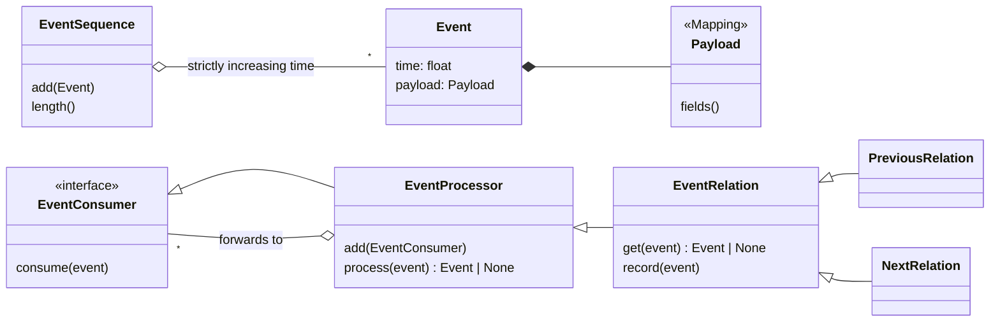

# Events (`cytlmonitor.events`)

Events are the input of every monitor. This package defines them and the
interface of everything that consumes them, plus processors that transform or
relate events before they reach a monitor.



```pycon
>>> from cytlmonitor import (Event, EventConsumer, EventProcessor, EventSequence,
...                          NextRelation, Payload, PreviousRelation)

```

## `Payload`

A read-only mapping of field names to values, the arguments of an event. It
behaves like a `dict` you cannot change: the dictionary it is built from is
copied.

```pycon
>>> p = Payload({'size': 60, 'protocol': 'TCP'})
>>> p['size'], p.get('tcp_syn', 0), sorted(p.fields()), len(p)
(60, 0, ['protocol', 'size'], 2)

```

Expressions read payloads through the functions they are given, such as
`lambda e: e.payload.get('tcp_syn', 0)` for a window counting SYN packets.

## `Event`

A time and a payload. Both are read-only, and events compare by value.

```pycon
>>> e = Event(1.5, p)
>>> e.time, e.payload['protocol']
(1.5, 'TCP')

```

## `EventSequence`

A finite sequence of events in strictly increasing time order, used by the
[offline functions](offline.md). Streams fed to monitors do not need one: any
iterable of events in non-decreasing order will do.

```pycon
>>> seq = EventSequence([Event(0, Payload({})), Event(2, Payload({}))])
>>> seq.length()
2
>>> seq.add(Event(2, Payload({})))
Traceback (most recent call last):
  ...
ValueError: Event time (2.0) must be strictly greater than the time of the last event in the sequence (2.0).

```

## `EventConsumer`

The interface of everything that receives events: a single method,
`consume(event)`. `StreamExpression`, `EventMonitor` and `EventProcessor`
implement it, so any of them can be the target of an event source.

## `EventProcessor`

An event consumer that transforms each event with `process(event)` and
forwards the result, unless it is `None`, to the consumers attached with
`add`. Subclasses implement `process`: a filter, a projection of the payload,
an enrichment.

```pycon
>>> class LargePackets(EventProcessor):
...     def process(self, e):
...         return e if e.payload['size'] > 100 else None
>>> class Print(EventConsumer):
...     def consume(self, e):
...         print('got', e.time)
>>> large = LargePackets()
>>> large.add(Print())
>>> for t, size in [(1, 60), (2, 1500), (3, 40)]:
...     large.consume(Event(t, Payload({'size': size})))
got 2.0

```

Since a monitor is also an event consumer, a processor can sit in front of
one: `large.add(monitor)` monitors only the large packets.

## `EventRelation`, `PreviousRelation`, `NextRelation`

Processors that forward every event unchanged and remember, for each, a
related event, to be looked up with `get(event)`. `PreviousRelation` relates
each event to the one before it, `NextRelation` to the one after it, once that
has arrived. Subclasses of `EventRelation` implement `record(event)`.

```pycon
>>> previous, following = PreviousRelation(), NextRelation()
>>> previous.add(following)                         # a chain of two processors
>>> events = [Event(t, Payload({})) for t in (1, 2, 4)]
>>> for e in events:
...     previous.consume(e)
>>> previous.get(events[0]) is None, previous.get(events[1]).time
(True, 1.0)
>>> following.get(events[1]).time, following.get(events[2]) is None
(4.0, True)

```

Relations keep one entry per event seen, so their memory grows with the
stream.
