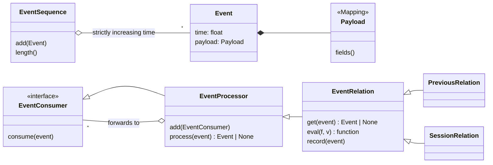

# Events (`cytlmonitor.events`)

Events are the input of every monitor. This package defines them and the
interface of everything that consumes them, plus processors that transform or
relate events before they reach a monitor.



```pycon
>>> from cytlmonitor import (Event, EventConsumer, EventProcessor, EventSequence,
...                          EventRelation, Payload, PreviousRelation,
...                          SessionRelation)

```

## `Payload`

A read-only mapping of field names to values, the arguments of an event. It
behaves like a `dict` you cannot change: the dictionary it is built from is
copied.

```pycon
>>> p = Payload({'size': 60, 'protocol': 'TCP'})
>>> p['size'], p.get('tcp_syn', 0), sorted(p.fields()), len(p)
(60, 0, ['protocol', 'size'], 2)

```

Expressions read payloads through the functions they are given, such as
`lambda e: e.payload.get('tcp_syn', 0)` for a window counting SYN packets.

## `Event`

A time and a payload. Both are read-only, and events compare by value.

```pycon
>>> e = Event(1.5, p)
>>> e.time, e.payload['protocol']
(1.5, 'TCP')

```

## `EventSequence`

A finite sequence of events in strictly increasing time order, used by the
[offline functions](offline.md). Streams fed to monitors do not need one: any
iterable of events in non-decreasing order will do.

```pycon
>>> seq = EventSequence([Event(0, Payload({})), Event(2, Payload({}))])
>>> seq.length()
2
>>> seq.add(Event(2, Payload({})))
Traceback (most recent call last):
  ...
ValueError: Event time (2.0) must be strictly greater than the time of the last event in the sequence (2.0).

```

## `EventConsumer`

The interface of everything that receives events: a single method,
`consume(event)`. `StreamExpression`, `EventMonitor` and `EventProcessor`
implement it, so any of them can be the target of an event source.

## `EventProcessor`

An event consumer that transforms each event with `process(event)` and
forwards the result, unless it is `None`, to the consumers attached with
`add`. Subclasses implement `process`: a filter, a projection of the payload,
an enrichment.

```pycon
>>> class LargePackets(EventProcessor):
...     def process(self, e):
...         return e if e.payload['size'] > 100 else None
>>> class Print(EventConsumer):
...     def consume(self, e):
...         print('got', e.time)
>>> large = LargePackets()
>>> large.add(Print())
>>> for t, size in [(1, 60), (2, 1500), (3, 40)]:
...     large.consume(Event(t, Payload({'size': size})))
got 2.0

```

Since a monitor is also an event consumer, a processor can sit in front of
one: `large.add(monitor)` monitors only the large packets.

## `EventRelation`, `PreviousRelation`, `SessionRelation`

Processors that forward every event unchanged and remember, for each, a
related event of its past, to be looked up with `get(event)`. Subclasses of
`EventRelation` implement `record(event)`, returning the related event or
`None`. That event must have been processed by the relation before: an event
can never be related to itself or to a later one, so its relation is known
as soon as it arrives. Any other event makes `consume` raise `ValueError`.
`PreviousRelation` relates each event to the one before it.

`eval(f, v)` turns a function `f` from events to floats into one evaluated on
the related event: it maps `e` to `f(e')` if `e` is related to `e'`, and to
`v` otherwise. It reads the relation when called, so it can be used by the
consumers the events are forwarded to, for example to compare an event with
the previous one.

```pycon
>>> previous = PreviousRelation()
>>> events = [Event(t, Payload({})) for t in (1, 2, 4)]
>>> for e in events:
...     previous.consume(e)
>>> previous.get(events[0]) is None, previous.get(events[2]).time
(True, 2.0)
>>> gap = previous.eval(lambda e: e.time, 0.0)      # time of the previous event
>>> [e.time - gap(e) for e in events]
[1.0, 1.0, 2.0]
>>> class FirstRelation(EventRelation):             # relates every event to the first
...     def __init__(self):
...         super().__init__()
...         self.first = None
...     def record(self, e):
...         if self.first is None:
...             self.first = e
...             return None
...         return self.first
>>> first = FirstRelation()
>>> for e in events:
...     first.consume(e)
>>> first.get(events[2]).time
1.0
>>> class Ahead(EventRelation):                     # not allowed: a future event
...     def record(self, e):
...         return Event(e.time + 1, Payload({}))
>>> Ahead().consume(events[0])
Traceback (most recent call last):
    ...
ValueError: An event can only be related to a past event: ...

```

`SessionRelation(f_open, f_close)` relates each event closing a session to
the event that opened it. `f_open` and `f_close` map an event to the index of
the session it opens or closes, or `None`. When an event `e` arrives,
`f_close` is evaluated first: if `f_close(e)` is an index opened by an event
`e'`, `e` is related to `e'`. Then, if `f_open(e)` is an index, `e` becomes
the event opening it, replacing the previous one. Closing an index does not
remove it, and `opened(i)` returns the latest event that opened `i`.

```pycon
>>> sessions = SessionRelation(lambda e: e.payload.get('login'),
...                            lambda e: e.payload.get('logout'))
>>> log = [Event(1, Payload({'login': 7})), Event(2, Payload({'login': 8})),
...        Event(3, Payload({'logout': 7})), Event(4, Payload({'logout': 9}))]
>>> for e in log:
...     sessions.consume(e)
>>> sessions.get(log[2]).time, sessions.get(log[3]) is None, sessions.opened(8).time
(1.0, True, 2.0)

```

Relations keep one entry per event seen, so their memory grows with the
stream.
