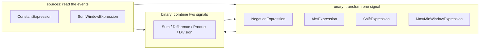

# Expressions (`cytlmonitor.expressions`)

An expression consumes events and publishes a real-valued signal, segment by
segment, to the `SignalConsumer`s attached with `add`. Expressions are the
quantitative half of a formula: counts and sums over windows, arithmetic, and
constants used as thresholds. Atomic monitors compare two of them.



Sources are the leaves of an expression tree: they read the events
themselves. Every other expression passes each event down to its operands
and transforms what they publish.

The examples below use this helper. It feeds an expression with events and
prints its signal, merging adjacent segments with the same value, which
expressions may publish separately:

```pycon
>>> from cytlmonitor import *
>>> class Collect(SignalConsumer):
...     def __init__(self):
...         self.segments = []
...     def consume(self, s):
...         last = self.segments[-1] if self.segments else None
...         if last and last.polynomial == s.polynomial and last.interval.just_before(s.interval):
...             self.segments[-1] = Segment(last.interval.join(s.interval), s.polynomial)
...         else:
...             self.segments.append(s)
>>> def show(expression, events):
...     out = Collect()
...     expression.add(out)
...     for t, fields in events:
...         expression.consume(Event(t, Payload(fields)))
...     for s in out.segments:
...         c = s.polynomial.coefficients
...         print(f'{str(s.interval):12} {c[0]:g}' if len(c) == 1 else f'{str(s.interval):12} {s.polynomial}')
>>> packets = [(1, {'size': 100}), (1.5, {'size': 40}), (4, {'size': 60}), (8, {'size': 0})]

```

## `StreamExpression`

The base class: an `EventConsumer` with a list of `SignalConsumer`s, `add(sc)`
to register one and `publish(segment)` to notify them all in order. Concrete
expressions implement `consume(event)`. See [the streaming
model](streaming-model.md#real-valued-signals-segments) for the contract on
the published segments.

## `ConstantExpression(value)`

The signal `f(t) = value`. At each event it publishes a constant segment from
the previous event to this one, so it is known exactly as far as the stream
has been read. It is the usual threshold of an atomic monitor.

```pycon
>>> show(ConstantExpression(5), packets[:2])
[0.0,1.5)    5

```

## `SumWindowExpression(w, from_, to)`

The sum of `w(e)` over the events `e` with `t + from_ <= e.time <= t + to`:
a count when `w` is `lambda e: 1.0`, a volume when it reads a size. The window
is *ahead* of `t`, so `f(t)` is known once the events up to `t + to` have
been seen. When an event at time `τ` arrives, the signal is published up to
`τ - to`. The expression keeps the events inside the window, at most those of
the last `to - from_` time units.

```pycon
>>> show(SumWindowExpression(lambda e: e.payload['size'], 0, 2), packets)
[0.0,1.0]    140
(1.0,1.5]    40
(1.5,2.0)    0
[2.0,4.0]    60
(4.0,6.0)    0

```

```text
events        100 (t=1)  40 (t=1.5)                 60 (t=4)
              |          |                          |
window [t, t+2] ahead of t:
f(0) = 140    [--------------------]
f(1.2) = 40          [--------------------]
f(2) = 60                       [--------------------]
```

## `ShiftExpression(arg, t)`

The signal of `arg` moved by `t`: `f(x) = g(x - t)`. With `t > 0` the signal
moves forward, and `[0, t)` is filled with 0. With `t < 0` it moves back, and
what falls before 0 is dropped. Shifting a sum over `[t, t + d]` forward by
`d` turns it into the sum over the *last* `d` time units, `[t - d, t]`, known
as soon as the events up to `t` have been seen:

```pycon
>>> show(ShiftExpression(SumWindowExpression(lambda e: e.payload['size'], 0, 2), 2), packets)
[0.0,2.0)    0
[2.0,3.0]    140
(3.0,3.5]    40
(3.5,4.0)    0
[4.0,6.0]    60
(6.0,8.0)    0

```

During the first `d` time units the result is 0, because there is no full
window yet. Here the volume over `[-0.5, 1.5]` (140) reads 0 at `t = 1.5`.

## Arithmetic: `SumExpression`, `DifferenceExpression`, `ProductExpression`, `DivisionExpression`

Point-wise operations on the signals of two expressions, `arg1 op arg2`.
Division by a signal that is 0 gives 0; dividing by a non-constant signal is
not supported. Below, `last2()` counts the packets of the last two seconds:

```pycon
>>> def last2():
...     return ShiftExpression(SumWindowExpression(lambda e: 1.0, 0, 2), 2)
>>> show(DifferenceExpression(last2(), ConstantExpression(1)), packets)
[0.0,2.0)    -1
[2.0,3.0]    1
(3.0,3.5]    0
(3.5,4.0)    -1
[4.0,6.0]    0
(6.0,8.0)    -1
>>> show(DivisionExpression(ConstantExpression(6), last2()), packets)
[0.0,2.0)    0
[2.0,3.0]    3
(3.0,3.5]    6
(3.5,4.0)    0
[4.0,6.0]    6
(6.0,8.0)    0

```

The two operands may publish at different paces and with different segment
boundaries. The base class `BinaryExpression` queues the segments of each
side and publishes the common part of the two front segments as soon as both
are available:

```text
arg1   [0 ------- 2)[2 --- 3](3 - 3.5]
arg2   [0 - 1)[1 --------------- 3.5)
out    [0 - 1)[1- 2)[2 --- 3](3 - 3.5]     each piece = arg1 op arg2 on it
```

Subclasses implement `_apply(p1, p2)`, combining the two polynomials.

## `NegationExpression(arg)`, `AbsExpression(arg)`

`-g(t)` and `|g(t)|`. They derive from `UnaryExpression`, which passes every
event to `arg` and transforms each of its segments with `_apply(segment)`
into the segments covering the same interval. `AbsExpression` splits a
segment where its polynomial changes sign.

```pycon
>>> show(AbsExpression(DifferenceExpression(last2(), ConstantExpression(1))), packets)
[0.0,3.0]    1
(3.0,3.5]    0
(3.5,4.0)    1
[4.0,6.0]    0
(6.0,8.0)    1

```

## `MaxWindowExpression(arg, from_, to)`, `MinWindowExpression(arg, from_, to)`

The maximum or minimum of the signal of `arg` over `[t + from_, t + to]`.
`arg` must be piecewise constant, such as a count. The signal is known up to
`to` behind `arg`. The candidates are kept in a monotonic queue: a segment is
dropped as soon as a later one supersedes it, so the queue holds at most the
segments of one window. `WindowExtremumExpression` is the base class.
Subclasses implement `_supersedes(a, b)`.

```pycon
>>> show(MaxWindowExpression(last2(), 0, 1), packets)
[0.0,1.0)    0
[1.0,3.0]    2
(3.0,6.0]    1
(6.0,7.0)    0
>>> show(MinWindowExpression(last2(), 0, 1), packets)
[0.0,2.0)    0
[2.0,2.0]    2
(2.0,2.5]    1
(2.5,4.0)    0
[4.0,5.0]    1
(5.0,7.0)    0

```

"Packets over the last two seconds stayed above 10 for the last 5 seconds"
is a minimum: `ShiftExpression(MinWindowExpression(last2(), 0, 5), 5)`
compared with `ConstantExpression(10)`.

## Building expressions

Every expression is an operand of at most one other: a parent passes it
every event, so with two parents it would see each event twice. Build each
use with a function returning a new instance, as `last2()` does above. The
same object may be both operands of a binary expression
(`ProductExpression(x, x)`): it is then fed once.
