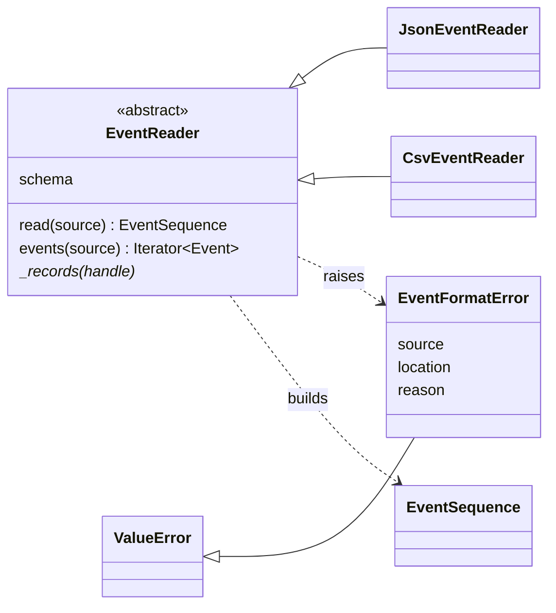

# Reading events from files (`cytlmonitor.io`)

The readers build a sequence of events from a JSON or a CSV file, checking on
the way that the times are consistent and that every field keeps the same
type. They can return a whole `EventSequence`, or yield the events one at a
time, so that a monitor can be fed while a large file is read.



A `source` is a path, or a text file already open (such as an
`io.StringIO`, used in the examples below).

```pycon
>>> import io
>>> from cytlmonitor import CsvEventReader, EventFormatError, JsonEventReader

```

## JSON files: `JsonEventReader`

The document mirrors the classes: an `EventSequence` is an object with a list
of `events`, each `Event` an object with a `time` and an optional `payload`,
the `Payload` mapping field names to values.

```pycon
>>> document = '''
... {
...   "events": [
...     {"time": 0.5, "payload": {"size": 60, "protocol": "TCP", "tcp_syn": true}},
...     {"time": 1.25, "payload": {"size": 1500, "protocol": "UDP"}},
...     {"time": 2}
...   ]
... }'''
>>> for e in JsonEventReader().read(io.StringIO(document)):
...     print(e)
Event(time=0.5, payload=Payload({'size': 60, 'protocol': 'TCP', 'tcp_syn': True}))
Event(time=1.25, payload=Payload({'size': 1500, 'protocol': 'UDP'}))
Event(time=2.0, payload=Payload({}))

```

Keys other than `events`, `time` and `payload` are rejected, so that a
misspelt `payload` is reported rather than silently ignored. A `null` value
leaves the field out of that event's payload. `NaN` and `Infinity`, which
Python's `json` module accepts but are not JSON, are rejected. Problems are
located by the index of the event, from 0.

## CSV files: `CsvEventReader`

The first row names the columns. The first column is the time, whatever its
name, and the others are the fields. Each following row is an event:

```pycon
>>> table = '''time,size,protocol,tcp_syn
... 0.5,60,TCP,true
... 1.25,1500,UDP,
... 2,40,TCP,false
... '''
>>> for e in CsvEventReader().read(io.StringIO(table)):
...     print(e)
Event(time=0.5, payload=Payload({'size': 60, 'protocol': 'TCP', 'tcp_syn': True}))
Event(time=1.25, payload=Payload({'size': 1500, 'protocol': 'UDP'}))
Event(time=2.0, payload=Payload({'size': 40, 'protocol': 'TCP', 'tcp_syn': False}))

```

A cell is read as a boolean if it is `true` or `false` (in any case), as a
number if it is an integer or a decimal (`12`, `-3.5`, `1e3`), and as a string
otherwise. An empty cell leaves the field out, as for `tcp_syn` at 1.25 above.
Every row must have one cell per column. Empty lines are skipped. Quoted cells
may contain the delimiter. `CsvEventReader(delimiter=';')` reads other
separators. Problems are located by line number.

## The checks

**Times.** Each time must be a number, finite, not negative, and strictly
greater than the time of the event before it, as `EventSequence` requires:

```pycon
>>> CsvEventReader().read(io.StringIO('time,size\n1,60\n1,70\n'))
Traceback (most recent call last):
  ...
cytlmonitor.io.reader.EventFormatError: line 3: the time 1.0 is not after the time of the previous event, 1.0

```

**Field types.** A value is a boolean, a number (an `int` or a `float`, which
may be mixed) or a string, and every field keeps the same type across the
events. Without a schema, the first value of a field sets its type, and the
error tells where it was set:

```pycon
>>> CsvEventReader().read(io.StringIO('time,size\n1,60\n2,1500\n3,big\n'))
Traceback (most recent call last):
  ...
cytlmonitor.io.reader.EventFormatError: line 4: field 'size': expected a number, as at line 2, got a string ('big')
>>> JsonEventReader().read(io.StringIO(
...     '{"events": [{"time": 1, "payload": {"syn": true}}, {"time": 2, "payload": {"syn": 1}}]}'))
Traceback (most recent call last):
  ...
cytlmonitor.io.reader.EventFormatError: event 1: field 'syn': expected a boolean, as at event 0, got a number (1)

```

Fields need not appear in every event: the events of the examples carry a
`login` field only for login attempts.

## Schemas

A schema maps field names to `bool`, `int`, `float` or `str`. It fixes the
types in advance, converts the values (`float` accepts integers and turns them
into floats; `int` requires integers), and rejects fields it does not list,
which catches misspelt column names:

```pycon
>>> reader = CsvEventReader(schema={'size': float, 'port': str})
>>> for e in reader.read(io.StringIO('time,size,port\n1,60,443\n2,70,https\n')):
...     print(e.payload)
Payload({'size': 60.0, 'port': '443'})
Payload({'size': 70.0, 'port': 'https'})
>>> reader.read(io.StringIO('time,size,prot\n1,60,x\n'))
Traceback (most recent call last):
  ...
cytlmonitor.io.reader.EventFormatError: line 2: field 'prot' is not in the schema

```

In a CSV file a `str` field keeps its cells as text. Without a schema, the
column `port` above would hold the number 443 and the string `https`, and be
rejected.

## Feeding a monitor from a file

`events(source)` checks and yields the events one at a time, so a monitor
processes a file of any size in constant memory. A problem in the file raises
an `EventFormatError` when the reader gets to it, after the events before it
have been processed:

```pycon
>>> from cytlmonitor import (AtomicGreaterMonitor, BooleanSignal, BooleanSignalConsumer,
...                          ConstantExpression, ShiftExpression, SumWindowExpression)
>>> class Record(BooleanSignalConsumer):
...     def __init__(self):
...         self.signal = BooleanSignal()
...     def consume(self, i):
...         self.signal.add(i)
...     def set_horizon(self, t):
...         self.signal.set_horizon(t)
>>> volume = ShiftExpression(SumWindowExpression(lambda e: e.payload['size'], 0, 1), 1)
>>> burst = AtomicGreaterMonitor(volume, ConstantExpression(2000))
>>> out = Record()
>>> burst.add(out)
>>> trace = 'time,size\n' + ''.join(f'{t / 4},{1500 if 8 <= t < 12 else 60}\n' for t in range(24))
>>> for event in CsvEventReader().events(io.StringIO(trace)):
...     burst.consume(event)
>>> out.signal                  # two 1500-byte packets within the last second
BooleanSignal([[2.25,3.5]])

```

With a path, the file is opened as UTF-8 and closed once the events are over:

```python
for event in CsvEventReader(schema={'size': int, 'protocol': str}).events('capture.csv'):
    monitor.consume(event)
```

## Errors

Every problem raises an `EventFormatError`, a `ValueError` whose message
starts with the file name, if any, and the location. Its attributes give the
parts separately: `source` (the path, or None), `location` (`'line 4'`,
`'event 2'`, or None for the file as a whole) and `reason`.

## Writing a reader for another format

Subclass `EventReader` and implement `_records(handle, error)`, which yields a
`(location, time, fields)` triple for each record, with the values as Python
objects (None for a missing value). `error(reason, location)` builds the
exception to raise for a record that cannot be read. The base class does
every check and builds the events, so that all formats are held to the same
rules.
