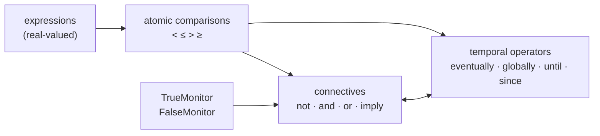
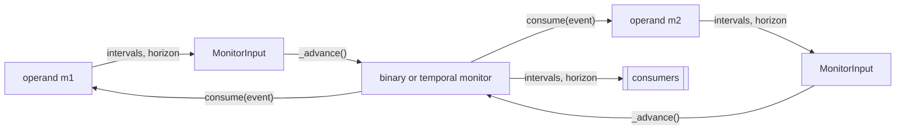
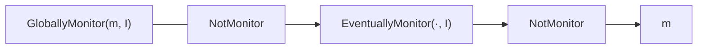

# Monitors (`cytlmonitor.monitors`)

A monitor consumes events and publishes a boolean signal to the
`BooleanSignalConsumer`s attached with `add`: the intervals where it is true,
in time order, and a horizon up to which it is final (see [the streaming
model](streaming-model.md#boolean-signals-intervals-and-horizons)).



Atomic monitors are the bridge from expressions. Connectives and temporal
operators then combine monitors freely.

## The examples on this page

To show the operators on simple signals, the examples use a small monitor,
`Flag`, which is true from each event whose payload sets a field up to the next
event. It is also an example of a new monitor written by subclassing
`EventMonitor` (see [composing monitors](composition.md#writing-a-new-operator)):

```pycon
>>> from cytlmonitor import *
>>> class Flag(EventMonitor):
...     """True from each event whose payload sets ``field`` up to the next event."""
...     def __init__(self, field):
...         super().__init__()
...         self.field, self.since, self.on = field, 0.0, False
...     def consume(self, e):
...         if self.on and e.time > self.since:
...             self.publish(Interval(self.since, e.time))
...         self.on, self.since = bool(e.payload.get(self.field)), e.time
...         self.publish_horizon(e.time)

```

`run` feeds a monitor with events at 0, 1, ..., 11, carrying two flags `a` and
`b`. It prints the signal as a strip, one character per second (`#` true at
the middle of that second, `.` false, `?` not known yet), then its intervals
and horizon:

```pycon
>>> class Record(BooleanSignalConsumer):
...     def __init__(self):
...         self.signal = BooleanSignal()
...     def consume(self, i):
...         self.signal.add(i)
...     def set_horizon(self, t):
...         self.signal.set_horizon(t)
>>> A = [0, 1, 1, 0, 1, 1, 1, 1, 0, 0, 0, 0]
>>> B = [0, 0, 0, 1, 0, 0, 0, 1, 1, 0, 0, 0]
>>> def run(name, monitor):
...     out = Record()
...     monitor.add(out)
...     for t in range(len(A)):
...         monitor.consume(Event(t, Payload({'a': A[t], 'b': B[t]})))
...     s = out.signal
...     cells = ''.join('?' if t + 0.5 >= s.horizon
...                     else '#' if any(i.contains(t + 0.5) for i in s) else '.'
...                     for t in range(len(A) - 1))
...     print(f'{name:12} {cells}   {" ".join(map(str, s)) or "never true"}, known up to {s.horizon:g}')
>>> run('a', Flag('a'))
a            .##.####...   [1.0,3.0) [4.0,8.0), known up to 11
>>> run('b', Flag('b'))
b            ...#...##..   [3.0,4.0) [7.0,9.0), known up to 11

```

## `EventMonitor`

The base class: an `EventConsumer` with a list of `BooleanSignalConsumer`s,
`add(c)` to register one, `publish(interval)` and `publish_horizon(t)` to
notify them all in registration order. Concrete monitors implement
`consume(event)`.

Two helpers support the monitors with operands. They are not exported:

* `MonitorInput` is the consumer a monitor installs in each operand. It
  buffers the operand's intervals and horizon, calls back the monitor's
  `_advance()` when the horizon moves, and provides `restricted_to(window)`,
  `compact()` and `discard_before(t)` so that the monitor keeps only what it
  still needs.
* `complement_within(signal, window)` returns where a signal is false within
  a window.



## `TrueMonitor`, `FalseMonitor`

The constants. At each event, `TrueMonitor` publishes `[previous event, this
event)` and moves the horizon to the event's time. `FalseMonitor` only moves
the horizon. Both are known exactly as far as the stream has been read.

```pycon
>>> run('true', TrueMonitor())
true         ###########   [0.0,11.0), known up to 11
>>> run('false', FalseMonitor())
false        ...........   never true, known up to 11

```

## Atomic comparisons

`AtomicLessMonitor(e1, e2)`, `AtomicLeqMonitor`, `AtomicGreaterMonitor` and
`AtomicGeqMonitor` are true where the signal of expression `e1` is `<`, `<=`,
`>`, `>=` that of `e2`. They derive from `AtomicComparisonMonitor`, which
builds an inner `DifferenceExpression` of the two and publishes where it is
positive (or non-negative), splitting each segment with
`Polynomial.positive`. Each subclass only sets two class attributes:
`_strict` (are equal values excluded) and `_reversed` (`>` rather than `<`).
The polynomials must have degree at most 2.

```pycon
>>> def count_last(seconds):
...     return ShiftExpression(SumWindowExpression(lambda e: 1.0, 0, seconds), seconds)
>>> busy = AtomicGreaterMonitor(count_last(2), ConstantExpression(1))
>>> out = Record()
>>> busy.add(out)
>>> for t in [1, 2, 2.5, 6]:
...     busy.consume(Event(t, Payload({})))
>>> out.signal, out.signal.horizon
(BooleanSignal([[2.0,4.0]]), 6.0)
>>> calm = AtomicLeqMonitor(count_last(2), ConstantExpression(1))
>>> out = Record()
>>> calm.add(out)
>>> for t in [1, 2, 2.5, 6]:
...     calm.consume(Event(t, Payload({})))
>>> out.signal
BooleanSignal([[0.0,2.0), (4.0,6.0)])

```

An atomic monitor is known as far as both expressions are, here up to the
last event, since the count looks back.

## Connectives: `NotMonitor`, `AndMonitor`, `OrMonitor`, `ImplyMonitor`

`NotMonitor(m)` publishes where `m` is false, over each newly known part of
`m`'s signal. `AndMonitor(m1, m2)`, `OrMonitor` and `ImplyMonitor` derive from
`BinaryMonitor`, which feeds both operands, collects their output through two
`MonitorInput`s and, once both have processed the event, combines the
newly decided part with `_combine`: intersection, union, and
`complement(m1) ∪ m2`.

```pycon
>>> run('not a', NotMonitor(Flag('a')))
not a        #..#....###   [0.0,1.0) [3.0,4.0) [8.0,11.0), known up to 11
>>> run('a and b', AndMonitor(Flag('a'), Flag('b')))
a and b      .......#...   [7.0,8.0), known up to 11
>>> run('a or b', OrMonitor(Flag('a'), Flag('b')))
a or b       .########..   [1.0,9.0), known up to 11
>>> run('a -> b', ImplyMonitor(Flag('a'), Flag('b')))
a -> b       #..#...####   [0.0,1.0) [3.0,4.0) [7.0,11.0), known up to 11

```

The result is decided up to the smaller of the two horizons, and further
while the operand known further holds its *dominant value*, the one deciding
the result alone. Each subclass declares it in `_dominant`, one value per
operand:

| Monitor | `_combine` | `_dominant` (m1, m2) |
| --- | --- | --- |
| `AndMonitor` | `s1 ∩ s2` | (false, false) |
| `OrMonitor` | `s1 ∪ s2` | (true, true) |
| `ImplyMonitor` | `not s1 ∪ s2` | (false, true) |

## `EventuallyMonitor(m, I)`

True at `t` when `m` is true at some `t + t'` with `t'` in `I`. Each interval
`m` publishes is moved back with `Interval.backward(I)` and published at once:
a true interval of `m` settles the part of the result it makes true. Where
`m` is false, the result is known `b` behind `m`, `b` being the end of `I`.
With an unbounded `I` only true intervals move the horizon. Here
`F[0,2] b` is not known yet on `[9, 11)`, where it depends on `b` after 11:

```pycon
>>> run('F[0,2] b', EventuallyMonitor(Flag('b'), Interval(0, 2, right_open=False)))
F[0,2] b     .###.####??   [1.0,4.0) [5.0,9.0), known up to 9

```

## `GloballyMonitor(m, I)`

True at `t` when `m` is true at every `t + t'` with `t'` in `I`. It is
built as `not eventually_I not m`, and republishes what that inner monitor
publishes:



Since `not m` being true settles the inner eventually at once, a globally is
decided as soon as `m` is seen false, without waiting for the window:

```pycon
>>> run('G[0,2] a', GloballyMonitor(Flag('a'), Interval(0, 2, right_open=False)))
G[0,2] a     ....##.....   [4.0,6.0), known up to 11

```

## `UntilMonitor(m1, m2, I)`

True at `t` when `m2` is true at some `t'` in `t + I` and `m1` is true on
`[t, t')`. `m1` is not required at `t'`, so `m1` may stop exactly where `m2`
starts. When `I` contains 0, `t' = t` is allowed and `m2` alone makes it true:
use a window such as `(0, b]` if that is not wanted. `I` must be bounded.

```pycon
>>> run('a U(0,2] b', UntilMonitor(Flag('a'), Flag('b'),
...                                Interval(0, 2, left_open=True, right_open=False)))
a U(0,2] b   .##..###...   [1.0,3.0) [5.0,8.0), known up to 11

```

The result is decided wherever computing it with the arguments' unknown
future taken as false, and as true, gives the same value. Every window is
known below `min(h1, h2) - b`, but the result is often decided further: for
instance, where `m1` is false and 0 is not in `I`.

## `SinceMonitor(m1, m2, I)`

The past counterpart of until: true at `t` when `m2` was true at some `t'`
with `t - t'` in `I` and `m1` has been true on `(t', t]`. `I` may be
unbounded, as in `(0, inf)`: "ever since". `t'` may also be the open end of an
interval of `m2`, as long as `t' < t`, so `m1` can take over right where `m2`'s
interval `[x, y)` ends. That is how `a S(0,2] b` is true on `(4, 6]` below.
With 0 in `I`, `m2` alone makes it true, as on `[3, 4)` and `[7, 9)`:

```pycon
>>> run('a S(0,2] b', SinceMonitor(Flag('a'), Flag('b'),
...                                Interval(0, 2, left_open=True, right_open=False)))
a S(0,2] b   ....##.#...   (4.0,6.0] (7.0,8.0), known up to 11
>>> run('a S[0,2] b', SinceMonitor(Flag('a'), Flag('b'), Interval(0, 2, right_open=False)))
a S[0,2] b   ...###.##..   [3.0,4.0) (4.0,6.0] [7.0,9.0), known up to 11

```

A since only looks back, so it is known as soon as both arguments are, and
with the same false/true bounds as until, often beyond: `m1` false at `t`
decides it when 0 is not in `I`. Its memory holds the stretch of `m1` still
true and the intervals of `m2` that can still be reached from it.

## Choosing windows

* `I` is relative to `t`: `[a, b]` is from `t + a` to `t + b` for the future
  operators, and from `t - b` to `t - a` for since.
* Exclude 0 (`(0, b]`) when the second argument alone must not make an until
  or since true.
* The more a monitor looks ahead, the later it can be decided when nothing
  settles it early: up to `b` behind the stream for eventually, globally and
  until.
