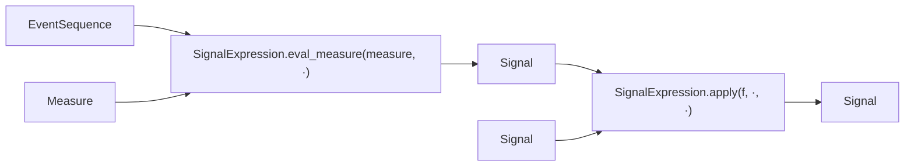

# Offline evaluation (`cytlmonitor.offline`)

The offline functions work on a complete `EventSequence` and on whole
`Signal`s, outside the streaming model. They are building blocks for
evaluating quantities over a recorded trace, and a reference to check online
results against.



```pycon
>>> from cytlmonitor import *

```

## `Measure(function, name=None)`

A named function from an `Event` to a float, validated to be callable. It is
the offline counterpart of the weight `w` given to a `SumWindowExpression`.

```pycon
>>> size = Measure(lambda e: e.payload['size'], name='size')
>>> size, size.evaluate(Event(1, Payload({'size': 60})))
(Measure('size'), 60.0)

```

## `SignalExpression`

A namespace of static methods producing `Signal`s; it is not meant to be
instantiated.

`eval_measure(measure, sequence)` is the signal that is 0 everywhere except at
the exact time of each event, where it takes the measure's value:

```pycon
>>> trace = EventSequence([Event(1, Payload({'size': 60})), Event(2.5, Payload({'size': 1500}))])
>>> for s in SignalExpression.eval_measure(size, trace):
...     print(s.interval, s.polynomial.coefficients[0])
[0.0,1.0) 0.0
[1.0,1.0] 60.0
(1.0,2.5) 0.0
[2.5,2.5] 1500.0

```

`apply(f, signal1, signal2)` combines two signals point-wise: their segments
are walked in lockstep, `f` is applied to the polynomials of each pair of
overlapping segments, and the longer one is split and carried forward. Once
one signal ends, the other is paired with `Polynomial.ZERO`. This is the
offline version of what `BinaryExpression` does online.

```pycon
>>> s1 = Signal([Segment(Interval(0, 2), Polynomial([1])), Segment(Interval(2, 4), Polynomial([0, 1]))])
>>> s2 = Signal([Segment(Interval(0, 1), Polynomial([5])), Segment(Interval(1, 4), Polynomial([2]))])
>>> for s in SignalExpression.apply(lambda p, q: p.add(q), s1, s2):
...     print(s.interval, s.polynomial)
[0.0,1.0) Polynomial([6.0])
[1.0,2.0) Polynomial([3.0])
[2.0,4.0) Polynomial([2.0, 1.0])

```
