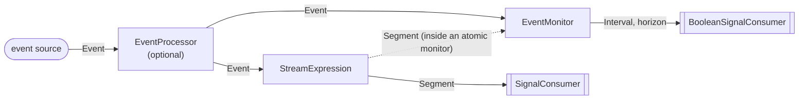
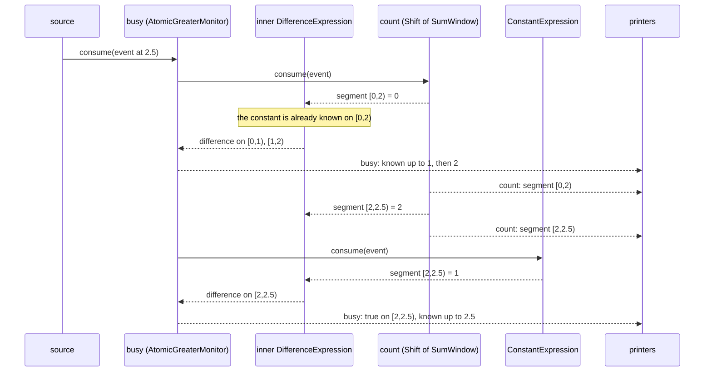

# The streaming model

Everything in CyTL Monitor is a stage of a pipeline. Three kinds of stream
flow through it, each with its own contract.



## Events

An `Event` is a time and a read-only `Payload` of fields. Stages receive
events through `EventConsumer.consume(event)`.

**Contract.** Events arrive in non-decreasing order of time. Several events
may share a timestamp; `SumWindowExpression` counts them all. Time starts at
0: signals are defined on `[0, +inf)`.

## Real-valued signals: segments

A `StreamExpression` publishes its signal as a sequence of `Segment`s, each an
`Interval` with the `Polynomial` giving the value there. Consumers receive them
through `SignalConsumer.consume(segment)`.

**Contract.** The segments are contiguous and in order: the first starts at 0,
and each one starts where the previous one ends, with exactly one of the two
containing the shared point. There is no separate horizon: the signal is
known up to the end of the last segment published. Operators with a window
looking ahead publish later than the events they read: a sum over
`[t, t + 2]` is known at `t` only once the events up to `t + 2` have been seen.

## Boolean signals: intervals and horizons

An `EventMonitor` publishes its boolean signal as the intervals where it is
true, plus a *horizon*. Consumers receive them through
`BooleanSignalConsumer.consume(interval)` and `set_horizon(t)`.

**Contract.**

* The intervals arrive in order, each lying before the next
  (`Interval.is_before`).
* Horizons never decrease, and each is at least the end of every interval
  published before it.
* A horizon `h` means: *the signal is final on `[0, h)`*. It is true on the
  intervals published so far and false on the rest of `[0, h)`.
* After horizon `h`, no interval starting before `h` is published.

A long true stretch is often published in pieces, `[2, 3]` then `(3, 4]`,
since each piece is published as soon as it is known. A consumer that needs
whole intervals can add the pieces to a `BooleanSignal`, which merges adjacent
intervals (see [consumers](consumers.md#reassembling-a-signal)).

## One event through a tree

The monitor below is true when more than one event arrived over the last two
seconds. Printers are attached both to the root and to the inner count:

```pycon
>>> from cytlmonitor import *
>>> class Segments(SignalConsumer):
...     def __init__(self, name):
...         self.name = name
...     def consume(self, s):
...         print(f'{self.name}: segment {s.interval} = {s.polynomial.coefficients[0]:g}')
>>> class Intervals(BooleanSignalConsumer):
...     def __init__(self, name):
...         self.name = name
...     def consume(self, i):
...         print(f'{self.name}: true on {i}')
...     def set_horizon(self, t):
...         print(f'{self.name}: known up to {t:g}')
>>> count = ShiftExpression(SumWindowExpression(lambda e: 1.0, 0, 2), 2)
>>> busy = AtomicGreaterMonitor(count, ConstantExpression(1))
>>> count.add(Segments('count'))
>>> busy.add(Intervals('busy'))
>>> for t in [1, 2, 2.5]:
...     print(f'-- event at {t}')
...     busy.consume(Event(t, Payload({})))
-- event at 1
-- event at 2
-- event at 2.5
busy: known up to 1
busy: known up to 2
count: segment [0.0,2.0) = 0
count: segment [2.0,2.5) = 2
busy: true on [2.0,2.5)
busy: known up to 2.5
>>> busy.consume(Event(6, Payload({})))
count: segment [2.5,3.0] = 3
count: segment (3.0,4.0] = 2
count: segment (4.0,4.5] = 1
count: segment (4.5,6.0) = 0
busy: true on [2.5,3.0]
busy: known up to 3
busy: true on (3.0,4.0]
busy: known up to 4
busy: known up to 4.5
busy: known up to 6

```

What happens:

1. The events at 1 and 2 produce no output. `SumWindowExpression(w, 0, 2)` sums
   over `[t, t + 2]`, so its value at `t` is only known once an event after
   `t + 2` arrives.
2. At 2.5 the window sum is known on `[0, 0.5)`. `ShiftExpression` moves it two
   seconds forward, to `[2, 2.5)`, and fills `[0, 2)` with 0. The count over
   the last two seconds therefore reads 0 during the first two seconds of the
   stream, before a full window exists.
3. The atomic monitor compares `count` with the constant through an inner
   `DifferenceExpression`. It publishes where the difference is positive,
   followed by the end of each difference segment as its horizon.
4. `busy`'s lines come before `count`'s: consumers are called in the order
   they were added, and `AtomicGreaterMonitor` registered its own consumer on
   `count` when it was built, before the printer.
5. At 6, the true stretch `[2, 4]` comes in three pieces, each published as
   soon as it is known.



## When results are published

Each monitor publishes its horizon as far as its result is *decided*: final
whatever its inputs turn out to be where they are not known yet. This is often
further than the point where every input is known.

**Constant and atomic monitors** are known as far as the stream (or their
expressions) has been read.

**Dominant values: And, Or, Imply.** `False and x` is false whatever `x` is.
While the operand known further holds its dominant value (false for And, true
for Or, a false premise or a true conclusion for Imply), the result moves past
the operand lagging behind. Below, `stuck` is an eventually with an unbounded
window over a signal that is never true: it can never be decided on a finite
stream, yet the conjunction is:

```pycon
>>> stuck = EventuallyMonitor(FalseMonitor(), Interval(0))
>>> m = AndMonitor(FalseMonitor(), stuck)
>>> m.add(Intervals('false and stuck'))
>>> for t in [1, 2]:
...     m.consume(Event(t, Payload({})))
false and stuck: known up to 1
false and stuck: known up to 2
>>> m = OrMonitor(EventuallyMonitor(FalseMonitor(), Interval(0)), TrueMonitor())
>>> m.add(Intervals('stuck or true'))
>>> for t in [1, 2]:
...     m.consume(Event(t, Payload({})))
stuck or true: true on [0.0,1.0)
stuck or true: known up to 1
stuck or true: true on [1.0,2.0)
stuck or true: known up to 2

```

**Lower and upper bounds: Until, Since.** These are monotone in both
arguments. Each update computes the result with the unknown future of each
argument taken as false, and again as true; wherever the two agree, any future
gives that value, so it is published. `x U[1,10) y` is false at `t` as soon as
`x` is false at `t`, without waiting ten seconds to see `y`:

```pycon
>>> m = UntilMonitor(FalseMonitor(), TrueMonitor(), Interval(1, 10))
>>> m.add(Intervals('false U[1,10) true'))
>>> for t in [1, 2]:
...     m.consume(Event(t, Payload({})))
false U[1,10) true: known up to 1
false U[1,10) true: known up to 2

```

A since can even be decided beyond both of its arguments. With `y` false up
to 4, `x S[3,4] y` needs `y` at some `t'` in `[t - 4, t - 3]`, so it is
false up to 7 whatever happens next:

```pycon
>>> m = SinceMonitor(EventuallyMonitor(FalseMonitor(), Interval(0)), FalseMonitor(),
...                  Interval(3, 4, right_open=False))
>>> m.add(Intervals('stuck S[3,4] false'))
>>> m.consume(Event(4, Payload({})))
stuck S[3,4] false: known up to 7

```

**Eventually** is known `b` behind its argument (`b` being the end of its
window) where the argument is false, but a true interval of the argument
settles the corresponding part of the result at once. With an unbounded
window, only true intervals move it.

When nothing decides the result early, the look-ahead operators (eventually,
globally, until) lag behind the stream by up to the length of their window.
Operators looking back (since) never lag behind their arguments.

## Memory

Operators keep only what can still change their future output: the events or
segments inside a window, and the intervals of their operands that reach past
their published horizon. Memory is bounded by the window lengths and by how
fragmented the signals are, not by the length of the stream.
